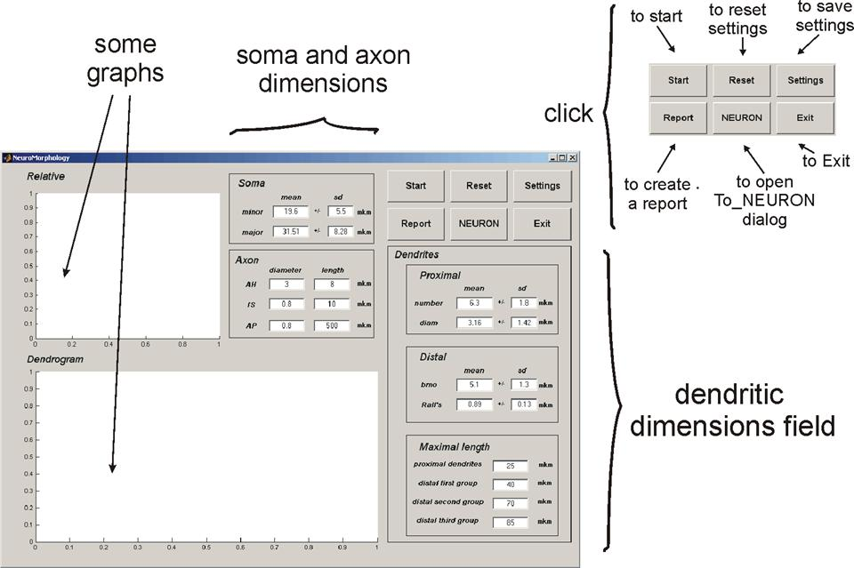
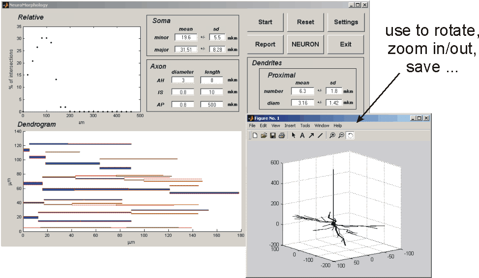
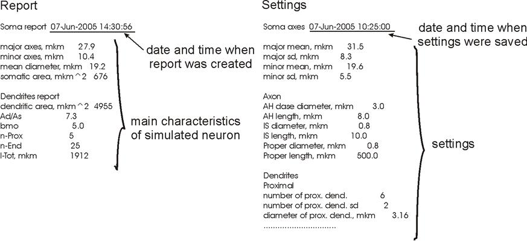
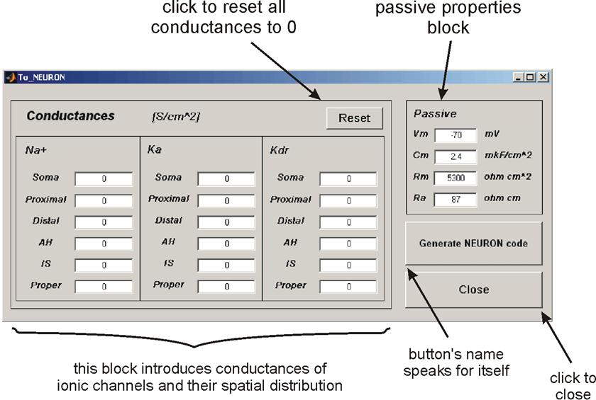
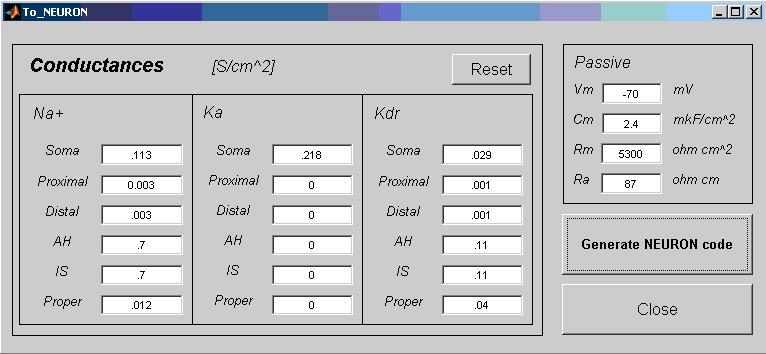
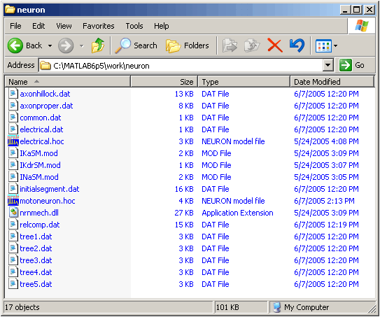
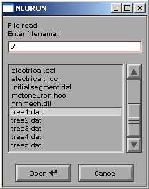
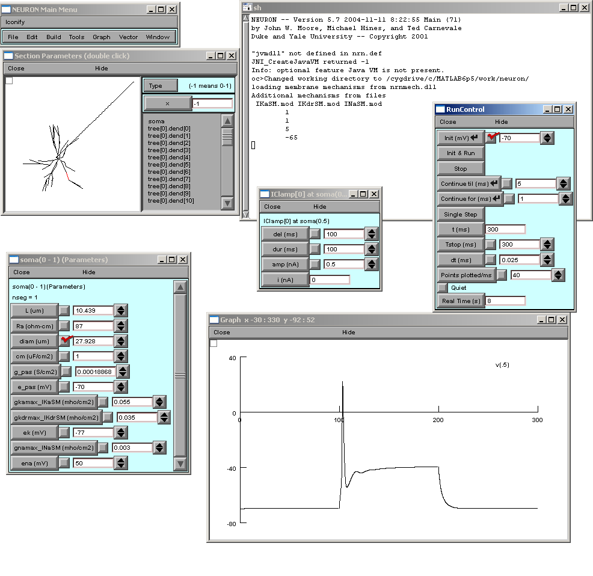

# Motoneuron-Morphology

Motoneuron-Morphology is a MATLAB based application, which simulates morphology of spinal motoneurons of the neonatal rat in the three dimensional space on the basis of experimental observations. Passive electrical properties and densities of three main voltage-activated (sodium and two potassium) channels can be selected for entire motoneuron or its sections. Subsequent application of the NEURON code for simulating the electrical properties of the modeled motoneuron is possible.

## Technical notes

Since NeuroMorphology was written as a MATLAB graphical user interface (GUI), it can only be run with MATLAB 6.5 (or later). MATLAB documentation and license information can be found on the [MATLAB home page](http://www.mathworks.com/products/matlab/). NEURON version 5.7.71 was freely downloaded from [NEURON home page](http://www.neuron.yale.edu/neuron/) at Yale University and used for electrical simulation of modeled motoneuron. NEURON documentation if necessary can be found at the same site.

## Downloading and running of NeuroMorphology

NeuroMorphology can be downloaded from this site as a *NeuroMorph.zip* archive containing the following eight MATLAB files and one folder (*neuron*) with additional six NEURON files:

- *axon.m*  
  M-file contains *axon* function which builds axon hillock, initial segment and axon proper with default or user defined lengths and diameters;

- *dendrites.m*  
  M-file contains *dendrites* function which simulates the dendritic tree of the motoneuron on the basis of stochastic variations of dendritic tree dimensions in the default or user defined boundaries;

- *dendrogram.m*  
  M-file contains *dendrogram* function which calculates relative complexity and builds a dendrogram of modeled motoneuron;

- *NeuroMorphology.fig*  
  file contains a complete description of the NeuroMorphology GUI figure layout and its components. This GUI should be selected from the MATLAB Open Existing GUI dialog (enter GUIDE at the MATLAB prompt);

- *NeuroMorphology.m*  
  M-file that contains the code that controls the NeuroMorphology GUI, including the callbacks for its components;

- *soma.m*  
  M-file is responsible for creating the soma as a prolate spheroid with the default or user defined dimensions;

- *To_NEURON.fig*  
  file contains a complete description of the To_NEURON GUI figure layout and its components. To_NEURON GUI is loaded from the NeuroMorphology interface after clicking on the NEURON button;

- *To_NEURON.m*  
  M-file that contains the code that controls the To_NEURON GUI and its callbacks;

- *neuron/electrical.hoc*  
  file contains set of commands which should be loaded to NEURON to define electrical properties of modeled motoneuron;

- *neuron/IKaSM.mod*  
  file contains description of the potassium fast (K_A) current specific for spinal motoneurons which was used for our simulation (see Safronov *et al.,* 2000);

- *neuron/IKdrSM.mod*  
  file contains description of the potassium delayed rectifier (K_DR) current expressed in the spinal motoneurons which was used for our simulation (see Safronov *et al.,* 2000);

- *neuron/INaSM.mod*  
  file contains description of the sodium current specific for spinal motoneurons which was used for our simulation (see Safronov *et al.,* 2000);

- *neuron/motoneuron.hoc*  
  file contains set of commands which produce loading of the modeled motoneuron’s morphology into the NEURON;

- *neuron/nrnmech.dll*  
  file contains compiled mechanisms (IKaSM, IKdrSM and INaSM) and should be loaded to NEURON for simulation of voltage-dependent currents.

Unpack *NeuroMorph.zip* archive into a MATLAB current directory and open *NeuroMorphology.fig* as an Existing GUI using MATLAB standard procedure. Briefly, to open NeuroMorphology enter GUIDE at the MATLAB prompt, go to the GUIDE Open Existing GUI dialog and open *NeuroMorphology.fig*. After opening the GUI, you can run it by selecting **Run** from the **Tools** menu or clicking the **Run** button on the GUIDE toolbar. If the directory where you unpack the *NeuroMorph.zip* is not on the MATLAB path change the current working directory to the directory containing *NeuroMorphology.fig* or add that directory to the MATLAB path.

## Using NeuroMorphology (an example)

After running the NeuroMorphology its graphical user interface will appear.

Picture below briefly introduces main parts of the interface:

Let's leave all the parameters as they are and just click on the **Start** button. Relative complexity graph and dendrogram would appear in the main window. Plus additional window with 3D neuron representation should become visible. MATLAB provides a set of useful tools to rotate, zoom in/out and save the 3D image.

To get numerical values describing simulated neuron click the **Report** button on the main panel. The *Report* file will appear in the MATLAB current directory. Sometimes it can be useful to save current setting (dimensions) in the separate file to compare different results or analyze data. To do so, click on the **Setting** button (after clicking *Settings* file will appear in the MATLAB current directory). For abbreviations and terms see [Glossary](Glossary.html).

If we are satisfied with the simulated neuron in terms of its morphology, let's try to introduce distributed voltage-dependent currents. Click on the **NEURON** button on the main window. To_NEURON dialog will appear. The following picture describes this dialog window.

At this point we would like to change *Na⁺*, Ka and *Kdr* conductances to certain values. After doing this To_NEURON dialog window should look like the following:

Click on the **Generate NEURON code** button to prepare data for electrical simulation. Now all the data are transformed to the code for further use with the NEURON simulator and saved in the MATLAB current directory’s folder *neuron* (if you unpack the NeuroMorphology archive rather than the MATLAB current directory, it is useful to copy all six NEURON files to the folder *neuron* now).

Files with *.dat* extension are created by NeuroMorphology, their names indicate their content.

## NeuroMorphology and NEURON

First of all, change the NEURON working directory to the *neuron* folder in the MATLAB working directory (it may be useful to copy simulation results to some another directory if you are going to create a network or something like this). If NEURON was installed properly, it should detect *nrnmech.dll* file in this directory and load membrane “mechanism” from it (*INaSM, IKaSM* and *IKdrSM*).

Commands translating neuron morphology into NEURON are located in the *motoneuron.hoc* file. Once this file has been loaded to NEURON, it automatically reads data from all generated files except *.dat* files whose name starts with “tree” (*tree1.dat* for example). NEURON will ask you to choose these files one by one as it shown here.

After you finish loading morphology, the next step is to load electrical properties of the simulated neuron. For this use *electrical.hoc*. Now everything is ready for simulation. By default, we introduced “single pulse current clamp point process” into the center of the soma (IClamp[0] at soma 0.5). Open the Voltage axis graph and the RunControl panel, then press **Init & Run** button to see the voltage response of the simulated neuron to the current step of 0.5 nA amplitude applied to the center of the soma. Results and NEURON’s panels are shown below. We just opened “Distributed Mechanism viewer/Shape Name/soma” to insure that we have correctly loaded the simulated neuron. The dimensions and electrical properties of the soma are the same as in the Soma report and To_Neuron dialog (see above).

---

2025-06-20: Converted README to Markdown.